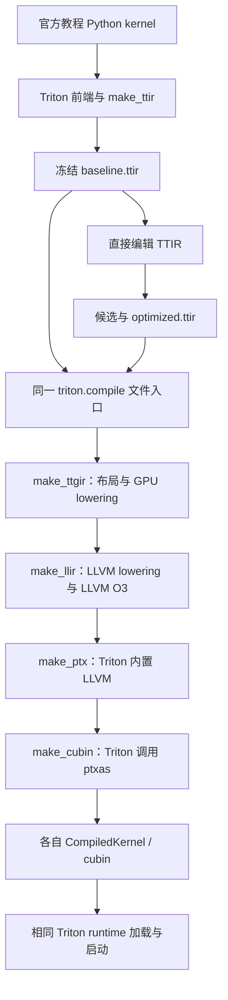

# TTIR 算子优化实验要求

本文用于在 `/root/ops-ttir-dev` 开展其他算子的 TTIR 优化实验，以现有 LayerNorm 为例。核心要求是：**只改变 TTIR 内容，baseline 与优化版从 TTIR 开始使用同一套 Triton 原生编译、加载、启动和计时流程。**

文中“必须”为实验约束；LayerNorm 的具体 shape、dtype、容差和启动参数只是示例，新算子需要单独确定并冻结。

## 1. 实验边界

- baseline 必须来自官方 Triton 教程或明确指定的原始实现，保存上游版本、来源、源码快照和 SHA256。
- 先完整跑通源码编译、TTIR 导出、TTIR 重编译、设备执行、正确性验证、性能测量，再开始优化。
- 纯 TTIR 实验只允许改 TTIR。禁止改 Python kernel 后重新导出并将其称为直接 TTIR 优化；禁止手工修改 TTGIR、LLVM IR、PTX、cubin 或替换已编译 kernel 的 binary。
- 测试代码可以使用 PyTorch 生成数据和计算参考值；被测算子的主机包装只负责检查、分配和启动设备 kernel，不调用 PyTorch compute 完成算子计算。
- 优化前冻结算子契约、测试集、容差、编译选项、启动方式和计时方法。同一轮 baseline 与候选必须遵守相同约束。
- 新 dtype、layout、shape 特化或不同编译配置，应另建实验分组，并提供匹配的 baseline；不能只为优化版改变配置。

## 2. 使用环境

### 必须使用的 Python 与 Triton

当前统一使用：

```bash
/root/venvs/ir-ops-dev/bin/python
```

| 项目 | 当前实验要求 |
|---|---|
| Python | 独立 venv，当前为 Python 3.12.3 |
| Triton | 官方 upstream Triton **3.7.0** |
| Triton 加载位置 | `/root/venvs/ir-ops-dev/lib/python3.12/site-packages/triton/` |
| FlagTree / FlagPrism | 不安装、不导入、不加载其定制 Triton |
| 系统 site-packages | 隔离，`include-system-site-packages=false` |
| PyTorch | 当前为 `2.12.0+cu130`；记录实际版本，参考和计时环境保持一致 |
| 本轮设备 | NVIDIA H100 80GB HBM3，SM90 |

不得仅根据 `triton.__version__` 判断环境正确，必须同时检查 Python、Triton 和 `libtriton.so` 的实际路径、安装分发信息和模块来源。避免 `PYTHONPATH`、`.pth` 等将系统或定制包加入加载路径。记录影响编译/运行的环境变量和工具路径；如 `LD_LIBRARY_PATH` 存在外部库路径，应核对实际加载组件，不能仅凭 venv 宣称所有动态库完全隔离。

最小查询：

```bash
/root/venvs/ir-ops-dev/bin/python - <<'PY'
import sys
import torch
import triton
from triton._C import libtriton
print('python:', sys.executable)
print('prefix:', sys.prefix)
print('torch:', torch.__version__)
print('triton:', triton.__version__, triton.__file__)
print('libtriton:', libtriton.__file__)
print('sys.path:', sys.path)
PY
```

参考实现：[`layer_norm/environment.py`](layer_norm/environment.py)。该模块拒绝错误 venv、错误 Triton 版本及 FlagTree/FlagPrism 包或源码标记；还提供 wheel RECORD 文件哈希检查。RECORD 检查证明文件符合本地安装记录，不代替远程官方发行包的独立来源校验。新环境应保存官方 wheel 来源及哈希。

### 设备隔离

运行前检查 `nvidia-smi`，选择空闲设备，再显式设置：

```bash
export CUDA_VISIBLE_DEVICES=7
```

- 同一设备不同时运行 benchmark、sanitizer、profiling 或其他 GPU 工作负载。
- 记录物理 GPU UUID、型号、驱动、时钟/功耗/温度等状态。
- baseline 和候选在同一物理 GPU 上交错测量；多张卡结果不可直接混为同一轮数据。
- 时钟是否锁定、缓存是否清理必须如实记录。未知或未检查的状态不能写为“已控制”。

## 3. Baseline 导出与冻结

1. 保存未经计算逻辑修改的教程 kernel。不要在冻结后格式化源文件再重新覆盖 baseline。
2. 确定一组 dtype、layout、constexpr、运行时参数签名和编译选项。
3. 通过正常的 `@triton.jit` 调用获得 `CompiledKernel`。
4. 将 `compiled.asm['ttir']` 保存为 `ir/baseline.ttir`，记录源码和 TTIR 哈希。
5. 将同一 `baseline.ttir` 交给 `triton.compile()`，执行并与源码调用对照。
6. baseline 一旦冻结不得隐式覆盖；新 baseline 必须有新的实验标识和证据。

LayerNorm 示例：[`layer_norm/export_baseline.py`](layer_norm/export_baseline.py)。导出时使用 `(M,N)=(1151,8192)`、FP16、`BLOCK_SIZE=8192`，baseline 中的 N 仍为运行时参数，并未固定为 8192。

必须检查导出 IR 的真实前提，包括指针对齐、`tt.divisibility`、整数范围、stride 和别名条件。LayerNorm 的 N/stride 带有 16 整除属性，因此本轮要求它们为正的 16 的倍数；不能直接沿用该 IR 测试不符合属性的尺寸。

若教程带 autotune，先记录每个测试用例或分组选择的配置，再冻结配置。正式 baseline/候选比较时不能让一边重新调参；若研究目标包含调参，必须作为单独因素报告。

## 4. 从 TTIR 开始的统一编译链



两版必须调用同一个编译函数，仅输入 TTIR 文件名不同：

```python
OPTIONS = dict(
    num_warps=8,
    num_ctas=1,
    num_stages=3,
    enable_fp_fusion=True,
)

baseline = triton.compile(str(baseline_path), options=OPTIONS)
optimized = triton.compile(str(optimized_path), options=OPTIONS)
```

这些参数为 LayerNorm 示例，不应原样强加给所有新算子。正式核查必须比较后端解析后的完整 options，而不只比较手写的四个字段；同时核对 target、extern libs、ptxas 选项、浮点选项、调试/插桩状态等。

当前冻结文件是 `make_ttir` 阶段结束后的 TTIR。Triton 3.7.0 的 TTIR 文件入口从 `make_ttgir` 继续，**不会再次执行 make_ttir**。源码路径到达同一 TTIR 截点后，使用相同的后续编译阶段。不得宣称文件入口仍完整执行了 Python 前端。

必须禁止可能替换编译阶段或产物的 override、`ir_override` 和 stage inspection 修改钩子。禁用只对某个版本生效的编译环境设置。编译缓存命中允许使用，但必须保存实际输入和产物哈希；缓存命中本身不代表这次重新执行过所有编译阶段。

### 不允许混入独立 llc 流程

主实验不可一边使用 Triton 原生后端，另一边使用 `llc → ptxas`。同一 LLVM 计算 IR 经不同后端参数可能产生不同机器码，例如 FMA 融合、地址生成和寄存器分配不同。

LayerNorm 已确认旧独立 llc baseline 与当前原生 baseline 的机器码不同；旧教程最初的原生 cubin 则与当前 baseline 机器指令一致。跨路线分析必须使用共同参考，并注明候选后端是否也已统一。详见 [`layer_norm/baseline_audit.md`](layer_norm/baseline_audit.md)。

## 5. Baseline 编译一致性门槛

每次主实验先进行 pipeline 核查，至少验证：

- 教程源码实际导出的 TTIR 与冻结 baseline 一致。
- 源码路径、baseline 文件路径和候选文件路径使用同一 Triton 环境、相同 target 和完整后端 options。
- 源码 baseline 与 TTIR baseline 的 LLVM IR、PTX 和 cubin 一致；当前 LayerNorm 已做到三者字节一致。
- TTGIR 若仅因 MLIR 解析打印出现 SSA 局部变量重命名，可以统一 parser round trip 后比较；不要把任意代码差异都当作命名差异忽略。
- 源码 baseline 与文件 baseline 在相同输入上的全部输出一致。LayerNorm 已验证 Y/Mean/Rstd 逐位一致。
- 记录两版实际输入 TTIR、各阶段产物、Triton 后端源码、`libtriton.so`、ptxas 的哈希。

若只能证明 `.text` 一致、完整 cubin 因调试信息不同而不一致，须明确记录区别及证据，不得写为“cubin 字节一致”。若出现实质代码差异，先定位，不能跳过并直接报告优化收益。

参考入口：[`layer_norm/verify_pipeline.py`](layer_norm/verify_pipeline.py)。新算子应实现自身 pipeline 验证，不可依赖 LayerNorm 的签名、输出个数或候选选择文件。

## 6. 加载与启动流程

编译后使用 Triton 原生 `CompiledKernel`，不手工热替换其 cubin、module、function 或 launch metadata。

Triton 3.7.0 中的流程：

```text
CompiledKernel
  → _init_handles()
      → Triton 创建 launcher
      → load_binary(name, cubin, shared, device)
      → 获得 CUDA module/function 及资源信息
  → ck[(grid_x, grid_y, grid_z)](*runtime_args)
      → 选择当前 CUDA stream
      → Triton launcher 传递函数、metadata 和参数
      → CUDA kernel
```

`ck[grid]` 本身会初始化加载句柄，正式测试可像 LayerNorm 一样在计时前显式调用 `_init_handles()` 完成加载和记录资源。`_init_handles` 是版本相关内部 API，所以需要固定 Triton 3.7.0 并在迁移版本时重新验证。

baseline/优化版必须共享一个 launcher 包装函数。LayerNorm 示例：

```python
def launch(ck, x, y, w, b, mean, rstd, eps):
    ck[(x.shape[0], 1, 1)](
        x, y, w, b, mean, rstd,
        x.stride(0), x.shape[1], eps,
    )
```

必须保持一致的事项包括：

- 入口签名和参数顺序、标量类型、实际输入、stride/layout、输出分配约定。
- grid、每 CTA warp 数、CTA 数及资源 metadata 的传递方式。
- CUDA device、stream、预热与同步边界。
- 同一组测试用例和同一套计时调用。

不要求优化后 registers/shared 等资源数量一致，它们正是优化可能改变的结果；必须按每版真实编译 metadata 加载，不能复制 baseline metadata 掩盖变化。若算法必须改变 grid、签名或工作区约定，应单独建实验，不能混为“仅改变 TTIR、固定启动契约”的结果。

性能计时前完成编译、模块加载和预热，不把 JIT、文件读写、模块加载时间计入设备 kernel 时间。新算子若需要多个 kernel，必须同样计入 baseline/候选完整设备执行序列，不能漏掉中间阶段。

参考代码：[`layer_norm/common.py`](layer_norm/common.py)。

## 7. 正确性验证

先验证正确性，再测性能；验证文件必须记录实际候选 TTIR 哈希，计时前检查哈希匹配。

测试矩阵应包含正常输入、边界尺寸、小/大 batch、分支边界、支持的 layout/stride 和数值压力分布。只测试满足冻结 IR 前提的用例；不支持的输入明确列出。

LayerNorm 示例：

| 内容 | 要求 |
|---|---|
| Y 参考 | native ATen LayerNorm，最大绝对误差 `<1e-2` |
| Mean 参考 | FP64 统计后转 FP32，`rtol=2e-5, atol=1e-5` |
| Rstd 参考 | FP64 中心化方差和 rsqrt 后转 FP32，`rtol=2e-4, atol=1e-5` |
| 压力分布 | constant、large offset、zero mean |
| 额外检查 | 有限性、输出覆盖、行尾 padding canary、不同 eps |
| 最终候选 | memcheck/racecheck；失败必须阻止接受候选 |

每次运行前重置输出 sentinel，避免上个版本的结果掩盖漏写。新算子必须确定自己的容差，不能简单复制 LayerNorm 的 `<1e-2`。涉及原子操作、输入原地修改或 RNG 时，还需规定状态重置、确定性与容差策略。

## 8. 性能验证

- 主指标先写清：kernel 时间、包含分配的调用时间或应用端到端时间。不同口径分别报告。
- 当前推荐用同一输入、预分配输出、CUDA graph replay 做 kernel 对照；使用同一 `triton.testing.do_bench_cudagraph`。
- baseline/候选交错测量，每轮随机对内顺序；保存全部样本和执行顺序，不只保存最快值。
- 先预热并同步，再测量；不在同一 GPU 并发跑正确性、profiling 或其他性能任务。
- LayerNorm 使用完整 30 shape、每点 7 轮、`rep=20ms`。每轮获得一对耗时，取配对加速比中位数，再对各 shape 汇总算术/几何平均。
- 新算子根据耗时和变异度设定次数，不将“30 shape / 7 轮”视为所有算子的唯一配置。
- 选定候选后用独立进程或不同种子复测，保留负结果和性能退步。
- 报告 registers、spill、shared 等资源变化；若用 occupancy，应区分理论值和实际 profiler 值。资源变化不是未经消融的性能因果证明。
- 固定配置的实验只证明该配置下的收益，不等于胜过教程 autotune 或所有应用场景。

CUDA graph replay 计时不包含 Python launch、输出分配、编译或加载时间，重复调用也会形成特定缓存状态。未控制冷热缓存就不能称作冷缓存结果；不能与教程默认 `do_bench` 或其他 LLIR 实验的不同指标直接混比。

## 9. 建议目录与入口

```text
<op>/
├── README.md                 # 契约、入口、当前结果
├── tutorial.py               # 冻结源码
├── upstream/                 # 原始教程快照、来源和哈希
├── export_baseline.py        # 导出/验证冻结 TTIR
├── environment.py            # 环境约束（也可复用共享实现）
├── common.py                 # 同一编译函数、同一 launcher
├── verify_pipeline.py        # 源码 baseline 与文件 baseline 一致性核查
├── make_candidates.py        # 确定性直接修改 TTIR
├── validate.py               # 正确性
├── benchmark.py              # 性能
├── test_accuracy.sh          # 正确性便捷入口
├── test_performance.sh       # 前置核查 + 正确性 + 性能
├── optimization_plan.md      # 假设、预算、测试协议
├── ir/
│   ├── baseline.ttir         # 不可变 baseline
│   ├── optimized.ttir        # 明确选中的版本
│   └── <candidate>.ttir      # 不可变候选，包括负结果
├── artifacts/                # 可再生 TTGIR/LLVM/PTX/cubin，可忽略
└── results/runs/<run_id>/    # 独立结果目录，禁止覆盖旧证据
```

这是建议结构，公共工具可逐步抽取；不要直接复制带 LayerNorm 参数和签名的脚本而不修改契约。若把 artifacts 排除出 Git，必须保留重建脚本、输入与产物哈希、资源记录和工具链指纹。

当前 LayerNorm 从仓库根目录运行：

```bash
CUDA_VISIBLE_DEVICES=7 bash layer_norm/test_accuracy.sh
CUDA_VISIBLE_DEVICES=7 bash layer_norm/test_performance.sh
```

## 10. Git 与交付验收

1. 初始化新算子目录，先提交冻结源码、baseline、契约和可运行流程。
2. 候选使用新名字/版本号；不得静默重写旧候选并沿用历史结果。
3. 每轮结果写新目录，保存命令、Git commit、环境、编译配置、IR/cubin 哈希、数值误差和全部性能样本。
4. 明确标记编译失败、正确性失败、性能退步、未运行和未验证；保留负结果。
5. 最终 `optimized.ttir` 必须有选中理由及指向候选的哈希对应，不能仅凭复制文件宣布最优。
6. 提交前运行 `pre-commit run --all-files`。冻结上游源码如有格式差异，应按项目规则排除格式化，而不是改写 baseline 来源。
7. 最终报告必须能回答：唯一改变是否为 TTIR？两版是否同一环境和后端？baseline 是否与教程原生产物一致？加载/启动/计时是否相同？数值是否通过？收益在哪些 shape 有效？有什么限制？

**接受条件：环境核查通过 → baseline 原生链一致性通过 → 候选正确性通过 → 同链路配对性能与复测完成 → 最终内存/同步检查通过 → 原始证据与 Git 归档完成。**
