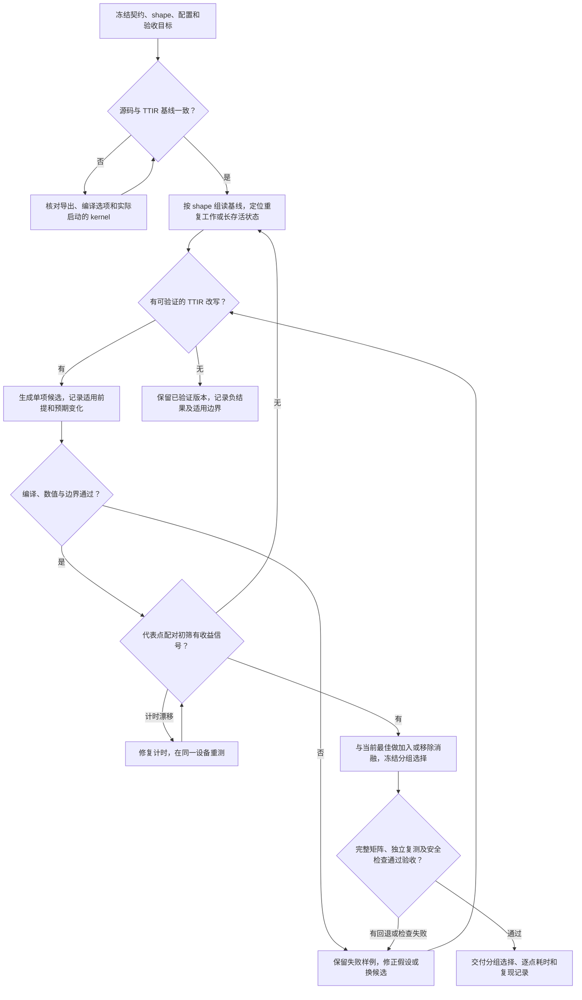

# 新算子的 TTIR 优化决策模型

拿到一个新算子，先写出它在哪些输入上必须算对，再从基线 TTIR 中找出一项可以消掉的具体工作。模型的输入是算子契约、冻结的基线和目标 shape；输出是每个配置组采用的 TTIR、采用或回退的理由，以及可复算的收益。以下决策来自 [13 项实验、379 个 shape 的总报告](../all_report.md)。

## 流程图



## 第一步：建立可信的起点

| 开工时回答 | 冻结的内容 |
|---|---|
| 算什么才算对？ | 全部输出、dtype、累加精度、layout/stride、对齐和别名约束。按算子写清容差、特殊值、量化舍入或并列值的 index 顺序。 |
| 要在哪些输入上快？ | 测速前列出完整 shape 矩阵、配置组、目标指标和可接受的最差回退。初筛从中覆盖短/长、整块/尾块及分派边界。另列正确性压力用例。 |
| 和哪个实现比？ | 固定源码版本、目标设备、后端选项、ABI、grid 和 kernel 序列。原版有 autotune 时先逐 shape 得到配置，再冻结 shape → 配置 → TTIR 哈希的映射。 |
| 能复现基线吗？ | 在本仓库使用官方 Triton 环境，运行该算子的编译链验证。核对源码导出的 TTIR、文件重编译后的 LLVM IR/PTX/cubin 及实际输出，再用两份相同基线做 A/A 计时，确定噪声范围。 |

默认直接编辑冻结 TTIR 的副本，保留原启动方式。若假设需要改变 host 参数或 kernel 数量，单列实验边界。MM 的 TMA 实验用相同 descriptor 参数接口的普通指针版本作匹配基线，描述符预先准备；其 31 点计时属于 B 级观测，且 racecheck 有告警。Sum 的小输入路径直接写出结果并省掉第二个 kernel，应计入两边完整设备序列。两例分别说明如何选择对照、如何定义计时范围。[实验协议](../TTIR_EXPERIMENT_REQUIREMENTS.md) · [MM 对照](../mm/report.md) · [Sum 对照](../sum/report.md)

## 第二步：从基线迹象选第一项改写

先挑能在基线中指认的那一行：哪个值重复加载、哪个状态跨循环一直活着、哪一级归约或归并做了多余的工作。下面每行都是一个起点。迁移到新算子后，每项都从待验证假设（D 级）开始。

| 在基线里看到什么 | 第一项 TTIR 候选 | 怎样判断假设成立，以及何时回退 | 报告中的先例 |
|---|---|---|---|
| 同一组参数沿某个轴被反复加载 | 在参数保持不变的轴上只加载一份，再广播 | 证明 tile 内参数索引相同。核对降低后的 load 和代表点耗时，跨组尾块单测 | [INT4 GEMM 的 scale/zero 窄加载](../int4_gemm/report.md) |
| 宽向量在多次归约或 dot 之间同时存活 | 缩窄逻辑 tile，或把只用一次的转换移到消费者之前 | 比较 registers、spill 和循环次数。长行若因重载或多轮循环回退，按组保留原宽度 | [LayerNorm 前向](../layer_norm/report.md) · [Attention dK/dV](../attention_dkdv/report.md) |
| 多个输出共享行统计，或同一标量参与大量除法 | 先试复用一个倒数；统计遍历重复时，单测联合归约 | 从所有输出检查误差。整数输出另查舍入边界。多个改写使用同一中间量时再测组合 | [RMSNorm＋INT8](../norm_quant/report.md) · [LayerNorm dX](../layer_norm/backward_dx/report.md) |
| 循环轮数可界定，短行大量填充，或相邻迭代的加载彼此独立 | 短行单 tile、长行有限展开或预加载，分别建候选 | 检查动态尾块、展开后的寄存器压力和分支两侧耗时。缩窄为 i32 前证明所有中间偏移都在范围内 | [Mean](../mean/report.md) · [var_mean](../var_mean/report.md) · [Logsumexp](../logsumexp/report.md) |
| 在选择循环里反复编码分数、搬运权重，或对已排序列表重复全量搜索 | 将不变的 key 移出循环、延迟 gather，或仅对各列表头部归并 | 保住并列顺序、索引、耗尽边界和中间列表的有序性。两阶段算法计入两个阶段 | [Partial Top-K](../partial_topk/report.md) · [MoE routing](../moe_routing/report.md) |
| 只剩流式读写，或小输入仍执行一个仅搬运结果的阶段 | 单测流式输出缓存提示；允许改启动方式时，另测直接写最终输出 | 缓存提示需跨工作集大小比较。移除阶段需核对输出绑定和完整序列。局部收益单独记录 | [Vector add](../vector_add/report.md) · [Sum](../sum/report.md) |

TTIR 可以改变张量宽度、控制流、数据依赖和访存表达式。物理寄存器、warp 布局和同步由后端决定。需要解释机制时，对比选定 shape 的 TTGIR、机器码、资源或 NCU 指标；是否采用仍由同口径配对计时决定。[TTIR 表达能力](ttir-model.md) · [诊断指标读法](diagnosis.md)

## 第三步：决定采用、继续还是回退

1. **先证正确。** 给候选独立版本名，记录父版本与 TTIR 哈希。用参考实现核对所有输出，覆盖分支阈值两侧、尾块及契约内特殊值。每次重置输出 sentinel，检查漏写与越界。失败时保留最小输入，修正后的候选另起版本。
2. **用同一对照筛选。** 在隔离的同一 GPU 上预热，固定输入、预分配输出，随机交错执行 baseline 与候选并保存每轮配对样本。沿用本报告口径时记录 CUDA graph 设备时间。A/A 漂移超出预设范围就排除该轮并重测。优化后若生成相同指令、使用相同启动和资源，先查计时波动。
3. **测清在什么组合中有效。** 单项对基线回答“单独做值不值”；新项加在当前最佳上回答“现在还值不值”。怀疑 A、B 有交互时，配对测原版、仅 A、仅 B、A+B；依赖不可拆就标明联合变化。历史反例是 var_mean：长行循环单独从 1024 缩到 256 为 **1.1658×**；已有短行复用与对齐提示时，再缩窄只有 **0.9665×**。该轮 30 点全组合消融及独立复测支持保留短行复用和对齐提示，舍弃长行缩窄（A 级）。[完整消融](../var_mean/ablation_v1/report_final.md)
4. **验收实际要交付的版本。** 先固定每个配置组采用候选或基线，再重跑这套选择的完整矩阵、独立进程复测和最终 memcheck/racecheck。每个 shape 取同轮 `基线时间 / 候选时间` 的中位数，再按冻结矩阵等权算术、几何平均。报告逐点基线时间、优化时间、加速比，以及最差回退。配置组回退后的版本也需重测，不能拼接各点历史最快值。
5. **停止条件。** 达到预设目标且检查通过，即可交付。候选改善落在 A/A 波动内、损害关键组，或已找不到有依据的新改写，就保留已验证版本并记录原因。最终判断附证据等级：A 为完整矩阵配对且独立复测，B 为初筛或确认受限的计时，C 为静态产物或单点线索，D 为待测假设。[证据分级](README.md#证据等级)

## 示例：第一次优化逐行 Softmax 怎么走

假设一个新的 FP16 逐行 Softmax 基线先读一遍 X 求最大值，再读 X 求指数与和。契约约定最后一维连续、输入有限、FP32 归约、输出 FP16，shape 同时有短行、长行和非整块尾部。以下是实验设计（D 级）。

- **首个候选。** 短行若能装入一个 tile，让同一次 `tt.load` 得到的值参与 max 和减 max，复用指数结果做 sum 与归一化。保持稳定 Softmax 公式、ABI 和 grid，长行先走原路径。预测是短行重复加载减少，代价是 X 和指数向量可能同时占用更多寄存器。
- **第一组对照。** 在分支阈值前后及带尾块的行上测试，尾部不参与 max 或 sum。用高精度参考核对每个输出，覆盖相等值和大幅值。检查生成代码中加载是否真的减少、是否出现 spill，再和原版配对计时。
- **按结果走分支。** 若短行稳定改善，再用冻结的短/长行选择做全矩阵复测。若编译器原已合并加载，或 spill 抵消收益，就保留基线，查下一个实际热点。这个新算子的加速比留给实测填写。

## 下次开工，复制这张任务卡

```text
请按《新算子的 TTIR 优化决策模型》优化 <算子名>。
基线源码/版本：<来源>              设备、Triton 和配置组：<环境>
输入与全部输出：<dtype、shape/stride、特殊值、容差、别名>
性能矩阵与计时范围：<shape 列表、kernel 或完整设备序列>
采用条件：<目标收益、关键组、可接受回退>    允许变动：<仅 TTIR / 另列 host 实验>
基线迹象：<哪个值、循环或阶段做了多余工作，影响哪些组>
首个候选：<父版本 → 一项改写；合法前提；预期能观察到什么>
验证记录：<编译链、数值与边界、A/A、配对样本、消融、独立复测、安全检查>
交付：<每组选择及 IR 哈希、逐点时间和加速比、平均与最差点、证据等级、回退理由>
```
