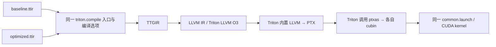

# LayerNorm TTIR 优化实验

从官方 Triton v3.7.0 教程前向实现导出并冻结 `ir/baseline.ttir`；在 TTIR 层直接改 IR，再通过官方 Triton 后端生成 cubin 并执行。没有手工修改下游 TTGIR/LLVM/PTX/cubin，也没有 Python kernel 替代优化候选。

- [首轮完整报告](report.md)
- [与 LLIR 的同条件对照及差距分析](llir_comparison.md)
- [Baseline 一致性核查与共同参考修正](baseline_audit.md)
- [推荐优化 TTIR](ir/optimized.ttir)
- [实验契约、假设和预算](optimization_plan.md)
- [教程来源与哈希](upstream/provenance.json)
- [baseline 流程证据](results/baseline_pipeline.json)
- [两版原生编译链与无 FlagTree 环境核查](results/native_pipeline_check.json)
- [正确性结果](results/accuracy_full.json)
- [首轮筛选](results/screening.json)
- [失败候选记录](results/failed_candidates.json)

## 环境与契约

H100 80GB HBM3 / SM90；Python 3.12、PyTorch 2.12.0+cu130、官方 Triton 3.7.0，复用 `/root/venvs/ir-ops-dev/bin/python`。

FP16 输入/权重/偏置/输出，FP32 累加及 Mean/Rstd；固定 8 warps、1 CTA、3 stages；baseline 逻辑 tile 为 8192。X/Y 行 stride 相同、列连续；N 与 stride 为正的 16 的倍数（冻结 TTIR 的编译前提），指针按 16 字节对齐，不支持别名。主性能矩阵是 M=4096、N=1024…15872、间隔 512。

## 复现

从仓库根目录执行，先用 `nvidia-smi` 选择空闲 GPU。完整流程可运行
`CUDA_VISIBLE_DEVICES=7 bash layer_norm/run_experiment.sh`，它会把新证据写到独立的
`results/reruns/<UTC时间>/`，保留本轮结果。下面是分步命令（复测时应给输出文件换名，避免覆盖已提交证据），使用 GPU 7：

```bash
export CUDA_VISIBLE_DEVICES=7
PY=/root/venvs/ir-ops-dev/bin/python

# 检查教程重新导出的 TTIR 与冻结文件一致，并执行 TTIR 路径
$PY layer_norm/export_baseline.py --verify

# 从冻结基线再生候选；已存在且内容不同会报错
$PY layer_norm/make_candidates.py

# 数值、压力、边界和 padding 检查
$PY layer_norm/validate.py baseline canonical arithmetic single_tile \
  tile_dispatch_v2 tile_dispatch_math_v2 --suite full \
  --output layer_norm/results/accuracy_full.json

# 配对计时，结果保存每一对 baseline/candidate 样本及执行顺序
$PY layer_norm/benchmark.py tile_dispatch_v2 tile_dispatch_math_v2 \
  --full --rounds 7 --rep 20 \
  --validation layer_norm/results/accuracy_full.json \
  --output layer_norm/results/full_benchmark.json

pre-commit run --all-files
```

测试脚本中的 PyTorch compute 仅用于造数据与参考计算，实际候选的 launch 仅执行从 TTIR 编译的设备 kernel。`artifacts/<候选>/` 包含编译后的所有阶段及资源元数据，可从 TTIR 再生，因此未纳入 Git。

原始教程提取文件保留上游排版，pre-commit 对其做路径排除；其他 Python 文件运行 black/isort/flake8。不要格式化教程后覆盖已冻结的 baseline。

计时指标为预分配输出的 CUDA graph replay kernel 时间，包含 Y、Mean、Rstd 的设备写出；没有输出分配和 CPU launch 时间。缓存由重复 graph 调用自然形成，未锁 GPU 时钟。不能直接与旧 LLVM 实验包含分配的加速比横向比较。

## 两版共用原生编译链



两份 TTIR 是教程 `make_ttir` 阶段后的 IR；文件入口从 `make_ttgir` 继续，两版都不额外重复 `make_ttir`。
教程源码走到同一阶段后也使用相同后端。核查已确认源码 baseline 与文件 baseline 的 LLVM IR、PTX、cubin
字节一致，TTGIR 只存在解析造成的局部 SSA 命名差异，统一解析后也一致。

`verify_pipeline.py` 检查源码、baseline、optimized 的完整后端选项/目标一致，并记录编译器、libtriton、ptxas 哈希。
`run_experiment.sh` 已将它接入前置流程；`common.compile_ir` 会拒绝错误环境和 kernel override/编译阶段替换。
当前优化 cubin 与首轮测量版本字节一致，因此原有性能数据仍对应这条统一的原生链；本次没有重新计时。

环境核查：Python 为 `/root/venvs/ir-ops-dev/bin/python`，Triton 为 **3.7.0**，隔离系统 site-packages。
没有安装 FlagTree/FlagPrism 包，没有可导入模块或 Triton Python 源码标记；362 个安装文件通过 pip wheel RECORD 哈希校验。
该校验确认文件符合本地安装记录，并不声称完成远程 wheel 的独立来源证明。系统 Python 环境已验证会被拒绝。

```bash
CUDA_VISIBLE_DEVICES=7 /root/venvs/ir-ops-dev/bin/python layer_norm/verify_pipeline.py \
  --output layer_norm/results/new_pipeline_check.json
```

新增完整数值复核见 `results/native_pipeline_accuracy.json`：baseline/optimized 各 142 个用例，共 284 次通过。
