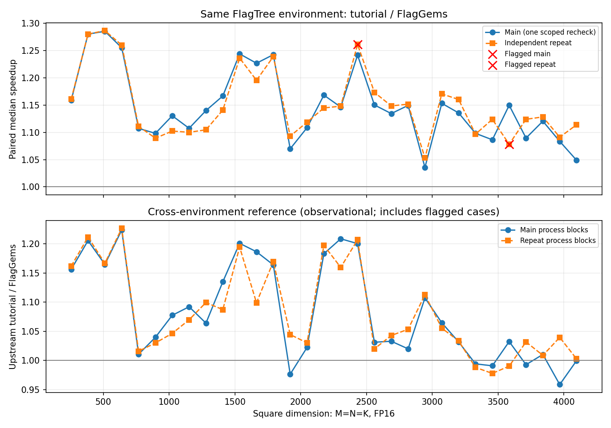

# FlagGems Hopper MM 与 Triton 教程：31点实测

主对比在**同一个FlagTree环境、同一张H100 GPU0**执行，
两边都按各自原始候选集逐shape调参后冻结：FlagGems相对教程的31点几何平均观测加速比为 **1.151×**，
独立进程复测 **1.152×**；
算术平均为1.152× / 1.154×。
主测/复测分别31/31、31/31点观测快于教程。

**存在波动超限点，以上是完整31点的观测汇总，不能作为全部31点均稳定通过的加速保证。** 主测无效标记点：[2688, 4096]；
复测：[2048, 2432, 3584, 3968]。
未丢弃这些点，
也未用最快轮次替换。
固定31点、已记录配对轮次条件下的95%bootstrap区间为[1.144,1.155] /
[1.144,1.162]，
不覆盖无效控制、调参选择偏差或所有跨进程系统变化。

## 比较对象和计时

FlagGems源码：[hopper/ops/mm.py](/root/FlagGems/src/flag_gems/runtime/backend/_nvidia/hopper/ops/mm.py)，
commit `ef8aea78fed8321c3e02a15bf31e847cd0579e4f`，
文件SHA256 `a09356973863e1020c069414626fe8237d11a9140b7aebce95d9334071584096`。
没有修改此文件或FlagGems库源码。
实际运行其`mm_out(a,b,out=c)`以预分配输出，
实际路径全部为 `general_mm → mm_kernel_general_host_tma`，
每点实际kernel、配置、完整metadata和IR/cubin hash见shape JSON。
`mm`对这组连续FP16输入走相同设备路径，
只额外分配输出；
本指标不包含该分配及Python包装耗时。

FlagTree侧使用已有`/usr/bin/python`，
FlagTree0.7.0，
实际加载Triton3.6.0、PyTorch2.11.0+cu130。
实际triton/__init__.py和libtriton.so均核对FlagTree本地RECORD相符，
真实路径及hash见environment.json。
当前H100缺少FlagTune模型包，
默认AUTO按源码回退default路径，
日志保留；
不是强制运行某个cost model。
FlagGems使用原声明默认候选集（运行时记录340配置），
没有人为缩减或改调参策略，
缓存限定在本比较目录。
TLE可用，
但本批FP16/H100不满足BF16/H20专用手工warp-specialized分支条件，
不能称这批在测该分支。

教程使用已冻结的官方v3.7.0 tutorial03计算源码，
**未加之前的unsigned TTIR优化**；
主比较在FlagTree环境中对官方16配置重新逐点autotune，
然后保存/冻结获选配置；
独立复测核对每点教程和FlagGems获选cubin字节相同，
禁止悄悄重新选择更快配置。
该环境实际共选出6套教程配置、15套FlagGems配置。
两边都是正常Triton编译/原生加载，
没有独立llc/ptxas路线或cubin热替换；
本比较是跨实现系统性能，
不是纯TTIR编辑收益实验。

输入为M=N=K=256…4096、步长128的完整31点，
连续行主序FP16，
FP16输出。
NumPy按seed+n生成相同CPU输入再上传，
逐点记录数据hash；
同环境配对使用同一份输入，
跨环境每个进程块也核对输入hash相同。
先正确性再计时：native FP16、禁TF32的FP32参考，
256/1024/4096另用CPU FP64；
容差atol=1e-2、rtol=1e-3，
输出NaN sentinel、有限性、输入不修改均检查。
四个完整进程块共186次实现/shape正确性检查通过，
具体误差逐点保存，
不把组合容差等同于绝对误差上限。

计时使用同一环境内同一`triton.testing.do_bench_cudagraph`，
每点5轮、rep=20ms、对内随机先后顺序、原始样本全部保留。
FlagGems计时调用实际公共`mm_out`，
包含其所有需要的设备工作；
descriptor等host准备、JIT/调参/模块加载不计入设备replay。
两边计时前预热10次并同步，
每轮还有同一教程kernel的A/A控制；
A/A中位比值偏离1超过3%或baseline轮次max/min超过1.15标记无效。
设备阶段检查未发现外来GPU0计算进程，
但不是连续独占证明；
未锁定/核实锁频，
无主动cache flush。
指标是**重复输入CUDA graph设备时间**，
不能当作含分配的Python调用或应用端到端加速。

## 对照原upstream教程环境

补充在原`/root/venvs/ir-ops-dev/bin/python`、官方Triton3.7.0/PyTorch2.12.0+cu130环境中，
重新运行原六组冻结教程baseline（未使用optimized.ttir）。
进程顺序为FlagTree主测 → upstream主测 → FlagTree独立复测 → upstream独立复测，
同一物理GPU0，
后两块seed123。
此项baseline保留原六组映射，
和FlagTree环境新选的教程配置可能不同。

`upstream教程耗时 / FlagTree FlagGems耗时`的全31点几何平均观测比值为 **1.080×** /
**1.080×**。
这不是同进程配对，
包含PyTorch、编译器、runtime及冻结配置不同的影响；
跨环境有效性标记并集为[2688, 2816, 3200, 3328, 3456, 3712, 3840, 3968, 4096] / [1920, 2048, 2432, 2816, 3328, 3584, 3712, 3968, 4096]，
因此只作观测参照，
不能归因于单独的kernel算法或FlagTree编译器。
没有拿历史GPU6结果直接除以本次GPU0时间。

## 全部逐点结果

加速比方向均为教程时间/FlagGems时间，
大于1表示FlagGems更快。
配对中位加速比不必等于两列耗时中位数相除。
跨环境列为主测进程块的两个中位数相除；
其单独有效性请结合原始upstream记录。

| M=N=K | 教程/FlagTree µs | FlagGems/FlagTree µs | 配对加速比 | 独立复测 | upstream教程 µs | 跨环境比值 | 有效性（主/复测） |
|---:|---:|---:|---:|---:|---:|---:|---|
| 256 | 2.980 | 2.572 | 1.159× | 1.161× | 2.975 | 1.156× | 有效/有效 |
| 384 | 3.634 | 2.838 | 1.280× | 1.280× | 3.421 | 1.206× | 有效/有效 |
| 512 | 4.253 | 3.309 | 1.286× | 1.287× | 3.854 | 1.165× | 有效/有效 |
| 640 | 4.594 | 3.671 | 1.255× | 1.260× | 4.492 | 1.224× | 有效/有效 |
| 768 | 5.386 | 4.858 | 1.107× | 1.111× | 4.909 | 1.010× | 有效/有效 |
| 896 | 5.832 | 5.312 | 1.098× | 1.089× | 5.522 | 1.040× | 有效/有效 |
| 1024 | 6.372 | 5.629 | 1.131× | 1.102× | 6.065 | 1.077× | 有效/有效 |
| 1152 | 10.106 | 9.124 | 1.108× | 1.100× | 9.964 | 1.092× | 有效/有效 |
| 1280 | 10.718 | 9.422 | 1.140× | 1.105× | 10.024 | 1.064× | 有效/有效 |
| 1408 | 12.318 | 10.480 | 1.167× | 1.141× | 11.894 | 1.135× | 有效/有效 |
| 1536 | 18.523 | 14.888 | 1.244× | 1.236× | 17.879 | 1.201× | 有效/有效 |
| 1664 | 20.823 | 16.971 | 1.227× | 1.196× | 20.136 | 1.186× | 有效/有效 |
| 1792 | 23.240 | 18.873 | 1.243× | 1.239× | 21.967 | 1.164× | 有效/有效 |
| 1920 | 25.738 | 25.428 | 1.070× | 1.093× | 24.824 | 0.976× | 有效/有效 |
| 2048 | 28.819 | 26.447 | 1.109× | 1.113× | 27.033 | 1.022× | 有效/波动超限 |
| 2176 | 46.036 | 39.076 | 1.168× | 1.145× | 46.230 | 1.183× | 有效/有效 |
| 2304 | 47.820 | 41.709 | 1.147× | 1.148× | 50.413 | 1.209× | 有效/有效 |
| 2432 | 58.418 | 46.713 | 1.242× | 1.255× | 56.077 | 1.200× | 有效/波动超限 |
| 2560 | 69.803 | 60.572 | 1.150× | 1.174× | 62.459 | 1.031× | 有效/有效 |
| 2688 | 76.443 | 66.302 | 1.159× | 1.149× | 68.481 | 1.033× | 波动超限/有效 |
| 2816 | 82.377 | 71.784 | 1.150× | 1.152× | 73.208 | 1.020× | 有效/有效 |
| 2944 | 100.133 | 96.673 | 1.036× | 1.053× | 107.043 | 1.107× | 有效/有效 |
| 3072 | 122.285 | 106.024 | 1.153× | 1.171× | 112.869 | 1.065× | 有效/有效 |
| 3200 | 133.742 | 118.029 | 1.136× | 1.160× | 121.764 | 1.032× | 有效/有效 |
| 3328 | 139.915 | 128.288 | 1.098× | 1.097× | 127.528 | 0.994× | 有效/有效 |
| 3456 | 156.839 | 141.365 | 1.086× | 1.124× | 140.049 | 0.991× | 有效/有效 |
| 3584 | 162.970 | 141.613 | 1.150× | 1.086× | 146.186 | 1.032× | 有效/波动超限 |
| 3712 | 205.047 | 188.651 | 1.090× | 1.124× | 187.261 | 0.993× | 有效/有效 |
| 3840 | 217.611 | 194.486 | 1.121× | 1.128× | 196.473 | 1.010× | 有效/有效 |
| 3968 | 228.652 | 214.340 | 1.084× | 1.175× | 205.450 | 0.959× | 有效/波动超限 |
| 4096 | 235.313 | 212.758 | 1.128× | 1.114× | 212.650 | 0.999× | 波动超限/有效 |

## 原始证据与复现

[results/flagtree_main/summary.json](results/flagtree_main/summary.json)、[flagtree_repeat](results/flagtree_repeat/summary.json)、[upstream_main](results/upstream_main/summary.json)、[upstream_repeat](results/upstream_repeat/summary.json)保存全部样本、精度、输入hash、配置和标记；
每组environment.json记录真实解释器、分发包、模块来源、compiler/timer/源码hash、命令和GPU状态。
原生阶段产物在各运行的artifacts目录，
可按源码和获选配置重建，
hash保存在JSON。
最早GPU5 smoke发现其他进程而拒绝运行，
其失败日志保留；
后续全部在GPU0。
最小点smoke只用于流程验证，
不替代上述31点统计。

参考[比较契约](README.md)，
重放入口为[run.sh](run.sh)。
只读审查按KernelForge review-agent在结果完成后核查；
该框架当前未注册MM执行适配器，
不能把本地对比称其CLI qualification。
原纯TTIR实验baseline/协议文件保持不变。

## 一次固定范围的有效性重测

按契约只对原先标记点做一次7轮重测，保持输入hash、两边配置及cubin完全相同；不按加速比选取轮次，不循环重试。原始完整结果如上保留。修复映射和summary哈希保存于analysis.json。

按该预先列定替换映射重构31点，几何均值为1.147× / 1.150×，剩余无效点为[] / [2432, 3584]。仍有超限点，因此本轮结论保留为约1.15×的观测优势，不宣称所有点稳定验证。附加重测共12次实现/shape精度检查通过，和原四进程块合计198次；这不是198个独立shape。

| 轮次 | 重测shape | 配对加速比 | A/A | baseline漂移 max/min | 有效性 |
|---|---:|---:|---:|---:|---|
| 主测 | 2688 | 1.135× | 1.023 | 1.122 | 有效 |
| 主测 | 4096 | 1.049× | 1.006 | 1.066 | 有效 |
| 复测 | 2048 | 1.119× | 1.011 | 1.037 | 有效 |
| 复测 | 2432 | 1.261× | 0.996 | 1.218 | 仍超限 |
| 复测 | 3584 | 1.078× | 0.995 | 1.224 | 仍超限 |
| 复测 | 3968 | 1.091× | 0.986 | 1.069 | 有效 |

